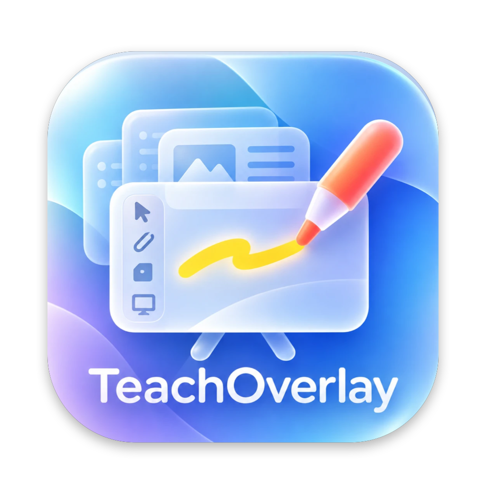

<h1 align="center">TeachOverlay</h1>

<a href="README.md">繁體中文</a> · <a href="README.zh-Hans.md">简体中文</a> · <b>English</b> · <a href="README.ja.md">日本語</a> · <a href="README.ko.md">한국어</a>

When you teach, record or stream, let your students and viewers see exactly what you press and where you click. TeachOverlay is a screen toolkit for teachers on the Mac: large keystroke display, mouse highlights and on-screen drawing, plus a whiteboard, timer, class bell and random picker.

## Features

### Make every action visible
- **Large keystroke display**: typing and shortcuts appear large on screen; shortcuts read like “Command + C Copy”
- **Shortcut history**: recent shortcuts stay in the top-left or top-right corner so students can follow along
- **Zhuyin input**: shows Bopomofo while you type Chinese, then the chosen characters
- **Mouse effects**: rings on double-click, a badge showing left or right button, and a ring while you hold
- **Spotlight**: dims everything except the area around the cursor
- **Magnifier**: zooms in on the area around the cursor
- **Multi-display**: everything shows on every display, including the projector

### Explain on screen
- **Annotate**: pen, highlighter, line, arrow, rectangle, ellipse
- **Auto shapes**: draw roughly, hold still for a moment, and it becomes a clean line, circle, rectangle or polygon
- **Ruler and compass**: a movable, rotatable ruler for straight lines along its edge, and a compass for circles and arcs
- **Whiteboard**: white, chalkboard, grid, lined and dotted backgrounds, multiple pages, save as images
- **Screenshot and annotate**: capture part of the screen and mark it up, then save or copy it into your slides

### Classroom helpers
- **Timer**: countdown and Pomodoro with big numbers floating on screen for the whole class
- **Class bell**: rings on your schedule (a built-in Westminster school chime, or your own sound) and sends a notification
- **Random picker**: pick from an imported roster or seat numbers, with no repeats, absent students skipped and custom ID formats; stop automatically, or keep it rolling until you call stop
- **Speaker timer**: green, yellow and red signals, with reminders at 2 minutes left, the last minute and time up; flashes and counts overtime; supports a speaker list
- **Full-screen clock**: a big digital or analog clock on all or selected displays, with time until the next bell
- **Blackout**: temporarily black out the projector while your laptop screen stays on
- **Notes**: write scripts or key points and float them on top of everything

### Privacy
- In **password, account and student ID** fields, the screen only shows “Hidden”
- In chat and social apps such as **LINE, Messenger and Instagram**, no keystrokes are shown at all
- All data stays on your Mac and is never uploaded

### Also
- Available in Traditional Chinese, Simplified Chinese, English, Japanese and Korean (follows your system language)
- Light and dark mode

## Download & install

1. Download the latest `.dmg` from [Releases](https://github.com/Yucheng0208/TeachOverlay/releases)
2. Open it and drag TeachOverlay to your Applications folder
3. If macOS says the app can't be opened the first time, go to **System Settings → Privacy & Security** and click **Open Anyway** near the bottom

**Requirements**: macOS 13 or later on an Apple Silicon (M-series) Mac

## First launch: permissions

TeachOverlay needs these permissions. Turn them on in **System Settings → Privacy & Security**:

| Permission | Used for |
|---|---|
| Accessibility | Mouse effects, detecting password and private fields, reading Zhuyin results |
| Input Monitoring | Showing keystrokes |
| Screen Recording | Magnifier and screenshot annotation (optional if you don't use them) |

No restart needed. The Permissions page in the app shows the current status.

## Shortcuts

| Shortcut | Action |
|---|---|
| ⌃⌥K | Keystrokes on/off |
| ⌃⌥C | Click pulse on/off |
| ⌃⌥S | Spotlight (Esc also turns it off) |
| ⌃⌥Z | Magnifier |
| ⌃⌥D | Annotate |
| ⌃⌥W | Whiteboard |
| ⌃⌥P | Screenshot and annotate |
| ⌃⌥T | Timer |
| ⌃⌥R | Random picker |
| ⌃⌥B | Blackout |
| ⌃⌥L | Full-screen clock |
| ⌃⌥V | Speaker timer |
| ⌃⌥X | Turn off all effects |

⌃ is Control and ⌥ is Option. While drawing, a toolbar appears at the top of the screen.

## FAQ

**Keystrokes aren't showing?**
Make sure Accessibility and Input Monitoring are both on. If it still doesn't work after an update, remove TeachOverlay from those lists in System Settings and add it again.

**Will students see my password?**
No. Password fields, password managers and terminals only show “Hidden”, and chat apps show nothing at all.

**Zhuyin shows only Bopomofo, no characters?**
Characters are read from the text field. Terminals and some web editors can't be read, so only Bopomofo is shown there.

**My laptop goes black too during blackout?**
With mirrored displays the laptop and projector share one picture. Switch to extended displays in **System Settings → Displays**. If every screen is black, click anywhere or press Esc to restore.

**The bell didn't ring?**
Turn on “Ring automatically on schedule” on the Bell page and check the school days and volume. The app has to keep running (it can stay in the menu bar).

## Feedback

Report problems or suggest ideas in [Issues](https://github.com/Yucheng0208/TeachOverlay/issues). To build or modify the app yourself, see the [development guide](docs/DEVELOPMENT.md) (Traditional Chinese).

## Author & license

Author: [Yu-Cheng Chang](https://github.com/Yucheng0208) ([website](https://www.yucheng208.net/))

Licensed under the [GNU General Public License v3.0](LICENSE). Icons by [Font Awesome Free](https://fontawesome.com) (icons CC BY 4.0, fonts SIL OFL 1.1).
