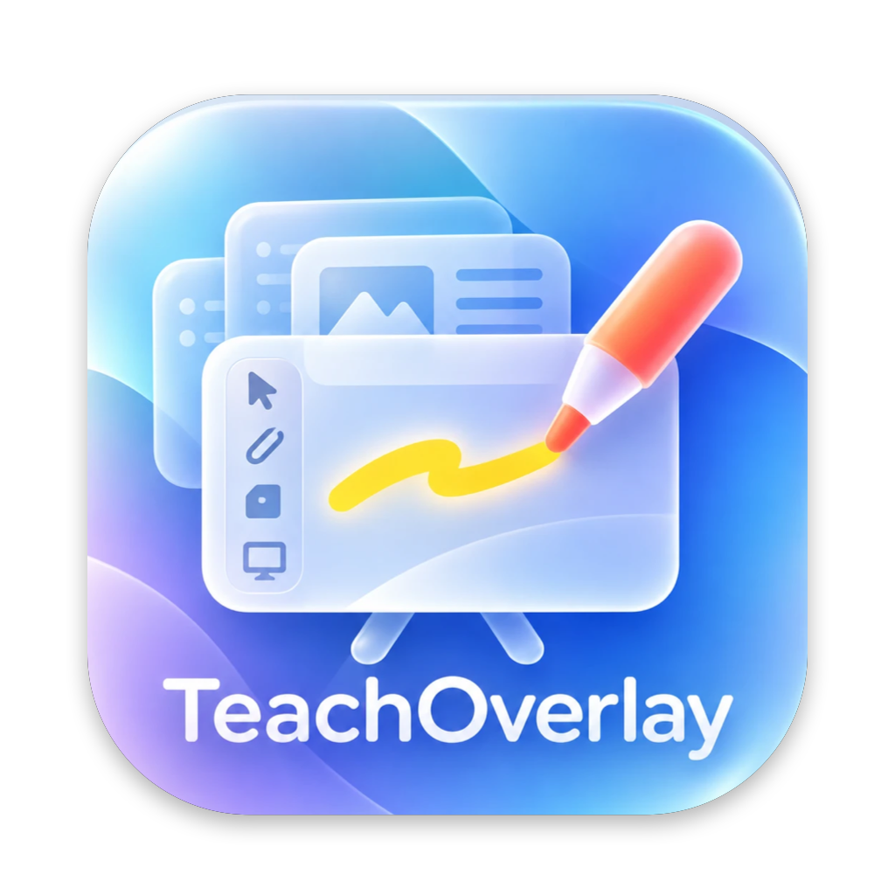

<h1 align="center">TeachOverlay</h1>

<a href="README.md">繁體中文</a> · <a href="README.zh-Hans.md">简体中文</a> · <a href="README.en.md">English</a> · <b>日本語</b> · <a href="README.ko.md">한국어</a>

授業・録画・配信で、何を押してどこをクリックしたかを生徒や視聴者にはっきり見せます。TeachOverlay は先生のための Mac 用画面ツールです。キーの拡大表示、マウスの強調、画面への描き込みに加え、ホワイトボード、タイマー、授業のチャイム、くじ引きも使えます。

## 機能

### 操作をはっきり見せる
- **キーの拡大表示**：入力とショートカットを画面に大きく表示。ショートカットは「Command + C コピー」のように表示
- **ショートカット履歴**：押したショートカットが左上か右上に残り、生徒が後から確認できます
- **注音入力**：中国語入力中は先に注音記号、変換後に漢字を表示
- **マウス効果**：ダブルクリックで広がる円、左右どちらのボタンかの表示、長押し中の円
- **スポットライト**：カーソル周辺以外を暗くします
- **拡大鏡**：カーソル周辺を拡大して見せます
- **複数ディスプレイ**：プロジェクターを含むすべての画面に表示

### 画面で説明する
- **描画**：ペン、蛍光ペン、直線、矢印、四角形、円
- **自動図形**：手描きしたあと少し止めると、きれいな直線・円・四角形・多角形に変わります
- **定規とコンパス**：移動・回転できる定規の辺に沿って直線を描け、コンパスで円や弧を描けます
- **ホワイトボード**：白板、黒板、方眼、罫線、ドットなどの背景。複数ページ、画像として保存可能
- **スクリーンショットに描き込み**：画面の一部を撮影してそのまま描き込み、保存やコピーでスライドに貼り付け

### 授業のお手伝い
- **タイマー**：カウントダウンとポモドーロ。大きな数字を画面に浮かべてクラス全員に表示
- **授業のチャイム**：時間割どおりに自動で鳴らし（学校のウェストミンスターの鐘を内蔵、好きな音にも変更可）、通知も表示
- **くじ引き**：名簿の読み込みや出席番号から抽選。重複なし、欠席の除外、学籍番号の形式指定も可能。自動で止めるか、先生がストップするまで回し続けるかを選べます
- **全画面時計**：デジタルまたはアナログの大きな時計を、すべての画面か選んだ画面に表示。次のチャイムまでの時間も表示できます
- **ブラックアウト**：プロジェクターの画面を一時的に黒くし、先生のノートはそのまま表示
- **メモ**：原稿や授業のポイントを書いて最前面に表示

### プライバシー保護
- **パスワード・アカウント・学籍番号**などの欄では「非表示」とだけ表示
- **LINE、Messenger、Instagram** などのチャット・SNS アプリではキーを一切表示しません
- データはすべて Mac の中だけに保存され、インターネットへ送信されません

### その他
- 繁体字中国語、簡体字中国語、英語、日本語、韓国語に対応（既定はシステムの言語）
- ライトモードとダークモードに対応

## ダウンロードとインストール

1. [Releases](https://github.com/Yucheng0208/TeachOverlay/releases) から最新の `.dmg` をダウンロード
2. 開いて TeachOverlay を「アプリケーション」フォルダにドラッグ
3. 初回に「開けません」と表示されたら、「システム設定 → プライバシーとセキュリティ」の下部で「このまま開く」をクリック

**動作環境**：macOS 13 以降、Apple Silicon（M シリーズ）搭載 Mac

## 初回起動：権限の許可

TeachOverlay の動作には次の権限が必要です。「システム設定 → プライバシーとセキュリティ」でオンにしてください。

| 権限 | 用途 |
|---|---|
| アクセシビリティ | マウス効果、パスワード欄やプライバシー欄の判定、注音の変換結果の読み取り |
| 入力監視 | キー入力の表示 |
| 画面収録 | 拡大鏡とスクリーンショットへの描き込み（使わない場合は不要） |

オンにした後の再起動は不要です。アプリ内の「権限」ページで状態を確認できます。

## ショートカット

| ショートカット | 機能 |
|---|---|
| ⌃⌥K | キー表示 オン／オフ |
| ⌃⌥C | クリック波紋 オン／オフ |
| ⌃⌥S | スポットライト（Esc でもオフ） |
| ⌃⌥Z | 拡大鏡 |
| ⌃⌥D | 画面に描画 |
| ⌃⌥W | ホワイトボード |
| ⌃⌥P | スクリーンショットに描き込む |
| ⌃⌥T | タイマー |
| ⌃⌥R | くじ引き |
| ⌃⌥B | ブラックアウト |
| ⌃⌥L | 全画面時計 |
| ⌃⌥X | すべての効果をオフ |

⌃ は Control、⌥ は Option です。描画中は画面上部にツールバーが表示されます。

## よくある質問

**キーが表示されない？**
「アクセシビリティ」と「入力監視」が両方オンか確認してください。アップデート後も表示されない場合は、システム設定で TeachOverlay を一度削除して追加し直してください。

**パスワードが生徒に見えてしまう？**
いいえ。パスワード欄、パスワード管理アプリ、ターミナルでは「非表示」とだけ表示され、チャットアプリでは何も表示されません。

**注音記号だけで漢字が出ない？**
漢字は入力欄から読み取ります。ターミナルや一部の Web エディタでは読み取れないため、注音記号のみ表示されます。

**ブラックアウトでノートも黒くなる？**
ミラーリング中はノートとプロジェクターが同じ画面です。「システム設定 → ディスプレイ」で拡張表示にしてください。すべて黒くなったときはクリックか Esc で戻ります。

**チャイムが鳴らない？**
「チャイム」ページで「時間割どおりに自動でチャイム」をオンにし、授業日と音量を確認してください。アプリは起動したままにしておく必要があります（メニューバーだけでも可）。

## フィードバック

不具合の報告やご提案は [Issues](https://github.com/Yucheng0208/TeachOverlay/issues) へどうぞ。自分でビルド・改造したい場合は[開発ガイド](docs/DEVELOPMENT.md)（繁体字中国語）をご覧ください。

## 作者とライセンス

作者：[Yu-Cheng Chang](https://github.com/Yucheng0208)（[Web サイト](https://www.yucheng208.net/)）

[GNU General Public License v3.0](LICENSE) で公開しています。アイコンは [Font Awesome Free](https://fontawesome.com)（アイコン CC BY 4.0、フォント SIL OFL 1.1）を使用しています。
