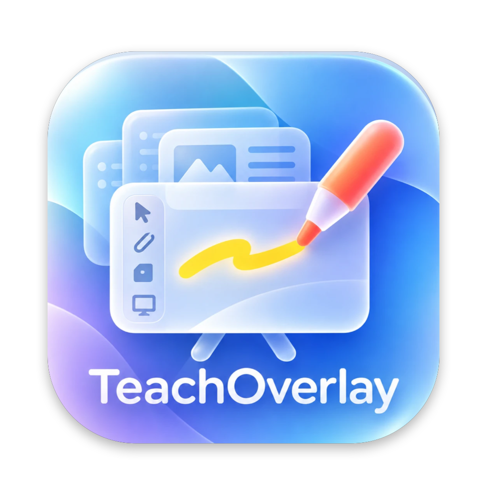

<h1 align="center">TeachOverlay</h1>

<a href="README.md">繁體中文</a> · <a href="README.zh-Hans.md">简体中文</a> · <a href="README.en.md">English</a> · <a href="README.ja.md">日本語</a> · <b>한국어</b>

수업, 녹화, 방송 중에 무엇을 누르고 어디를 클릭하는지 학생과 시청자가 잘 볼 수 있게 해 줍니다. TeachOverlay는 선생님을 위한 Mac 화면 도구입니다. 키 크게 표시, 마우스 강조, 화면에 그리기는 물론 화이트보드, 타이머, 수업 종, 뽑기까지 들어 있습니다.

## 기능

### 조작을 잘 보이게
- **키 크게 표시**: 입력과 단축키를 화면에 크게 표시하며, 단축키는 'Command + C 복사'처럼 보여 줍니다
- **단축키 기록**: 누른 단축키가 왼쪽 위나 오른쪽 위에 남아 학생들이 따라 하기 쉽습니다
- **주음 입력**: 중국어를 입력할 때 먼저 주음 부호를, 변환 후 한자를 표시합니다
- **마우스 효과**: 더블클릭 시 퍼지는 원, 왼쪽/오른쪽 버튼 표시, 길게 누르는 동안의 원
- **스포트라이트**: 커서 주변만 밝히고 나머지를 어둡게 합니다
- **돋보기**: 커서 주변 화면을 확대해 보여 줍니다
- **여러 화면 지원**: 프로젝터를 포함한 모든 화면에 표시됩니다

### 화면에서 설명하기
- **화면 주석**: 펜, 형광펜, 직선, 화살표, 사각형, 원
- **자동 도형**: 대충 그린 뒤 잠시 멈추면 반듯한 직선, 원, 사각형, 다각형으로 바뀝니다
- **자와 컴퍼스**: 옮기고 돌릴 수 있는 자의 가장자리를 따라 직선을 긋고, 컴퍼스로 원과 호를 그립니다
- **화이트보드**: 화이트보드, 칠판, 모눈, 줄, 점 배경과 여러 페이지, 이미지로 저장
- **스크린샷 주석**: 화면 일부를 캡처해 바로 표시하고 저장하거나 복사해 슬라이드에 붙여 넣기

### 수업 도우미
- **타이머**: 카운트다운과 뽀모도로. 큰 숫자를 화면에 띄워 반 전체가 볼 수 있습니다
- **수업 종**: 시간표대로 자동으로 종을 울리고(학교 웨스트민스터 차임 내장, 원하는 소리로 변경 가능) 알림을 보냅니다
- **뽑기**: 명단을 가져오거나 번호로 뽑기. 중복 없이, 결석자 제외, 학번 형식 지정 가능. 자동으로 멈추거나 선생님이 멈출 때까지 계속 돌릴 수 있습니다
- **전체 화면 시계**: 디지털 또는 아날로그 큰 시계를 모든 화면이나 선택한 화면에 표시하고, 다음 종까지 남은 시간도 보여 줍니다
- **화면 끄기**: 프로젝터 화면을 잠시 검게 하고 선생님 노트북은 그대로 보입니다
- **메모**: 대본이나 수업 요점을 적어 맨 위에 띄워 둘 수 있습니다

### 개인정보 보호
- **비밀번호, 계정, 학번** 등의 칸에서는 화면에 '숨김'으로만 표시됩니다
- **LINE, Messenger, Instagram** 같은 채팅·SNS 앱에서는 키를 전혀 표시하지 않습니다
- 모든 데이터는 Mac에만 저장되며 인터넷으로 전송되지 않습니다

### 그 밖에
- 번체 중국어, 간체 중국어, 영어, 일본어, 한국어 지원 (기본값은 시스템 언어)
- 라이트 모드와 다크 모드 지원

## 다운로드 및 설치

1. [Releases](https://github.com/Yucheng0208/TeachOverlay/releases)에서 최신 `.dmg`를 다운로드합니다
2. 열고 TeachOverlay를 '응용 프로그램' 폴더로 드래그합니다
3. 처음 열 때 '열 수 없음'이 표시되면 **시스템 설정 → 개인정보 보호 및 보안** 아래쪽에서 **그래도 열기**를 누르세요

**시스템 요구 사항**: macOS 13 이상, Apple Silicon(M 시리즈) Mac

## 처음 사용: 권한 허용

TeachOverlay가 작동하려면 다음 권한이 필요합니다. **시스템 설정 → 개인정보 보호 및 보안**에서 켜 주세요.

| 권한 | 용도 |
|---|---|
| 손쉬운 사용 | 마우스 효과, 비밀번호·개인정보 칸 감지, 주음 변환 결과 읽기 |
| 입력 모니터링 | 키 입력 표시 |
| 화면 기록 | 돋보기와 스크린샷 주석 (사용하지 않으면 필요 없음) |

켠 뒤 다시 시작할 필요는 없습니다. 앱의 '권한' 페이지에서 상태를 확인할 수 있습니다.

## 단축키

| 단축키 | 기능 |
|---|---|
| ⌃⌥K | 키 표시 켜기/끄기 |
| ⌃⌥C | 클릭 파동 켜기/끄기 |
| ⌃⌥S | 스포트라이트 (Esc로도 끔) |
| ⌃⌥Z | 돋보기 |
| ⌃⌥D | 화면 주석 |
| ⌃⌥W | 화이트보드 |
| ⌃⌥P | 스크린샷 후 주석 |
| ⌃⌥T | 타이머 |
| ⌃⌥R | 뽑기 |
| ⌃⌥B | 화면 끄기 |
| ⌃⌥L | 전체 화면 시계 |
| ⌃⌥X | 모든 효과 끄기 |

⌃는 Control, ⌥는 Option입니다. 그리는 동안 화면 위쪽에 도구 막대가 나타납니다.

## 자주 묻는 질문

**키가 표시되지 않나요?**
'손쉬운 사용'과 '입력 모니터링'이 모두 켜져 있는지 확인하세요. 업데이트 후에도 안 되면 시스템 설정에서 TeachOverlay를 제거한 뒤 다시 추가하세요.

**비밀번호가 학생에게 보이나요?**
아니요. 비밀번호 칸, 비밀번호 관리 앱, 터미널에서는 '숨김'으로만 표시되고 채팅 앱에서는 아무것도 표시되지 않습니다.

**주음 부호만 나오고 한자가 없나요?**
한자는 입력란에서 읽어 옵니다. 터미널과 일부 웹 편집기에서는 읽을 수 없어 주음 부호만 표시됩니다.

**화면 끄기를 하면 노트북도 꺼지나요?**
미러링 중에는 노트북과 프로젝터가 같은 화면입니다. **시스템 설정 → 디스플레이**에서 확장 모드로 바꾸세요. 모든 화면이 꺼졌을 때는 클릭하거나 Esc를 누르면 돌아옵니다.

**종이 울리지 않나요?**
'종' 페이지에서 '시간표대로 자동으로 종 울리기'를 켜고 수업 요일과 음량을 확인하세요. 앱이 계속 실행 중이어야 합니다(메뉴 막대에만 있어도 됩니다).

## 의견 보내기

문제 신고나 제안은 [Issues](https://github.com/Yucheng0208/TeachOverlay/issues)에 남겨 주세요. 직접 빌드하거나 수정하려면 [개발 가이드](docs/DEVELOPMENT.md)(번체 중국어)를 참고하세요.

## 만든 사람 및 라이선스

만든 사람: [Yu-Cheng Chang](https://github.com/Yucheng0208) ([웹사이트](https://www.yucheng208.net/))

[GNU General Public License v3.0](LICENSE)으로 배포됩니다. 아이콘은 [Font Awesome Free](https://fontawesome.com)(아이콘 CC BY 4.0, 글꼴 SIL OFL 1.1)를 사용합니다.
