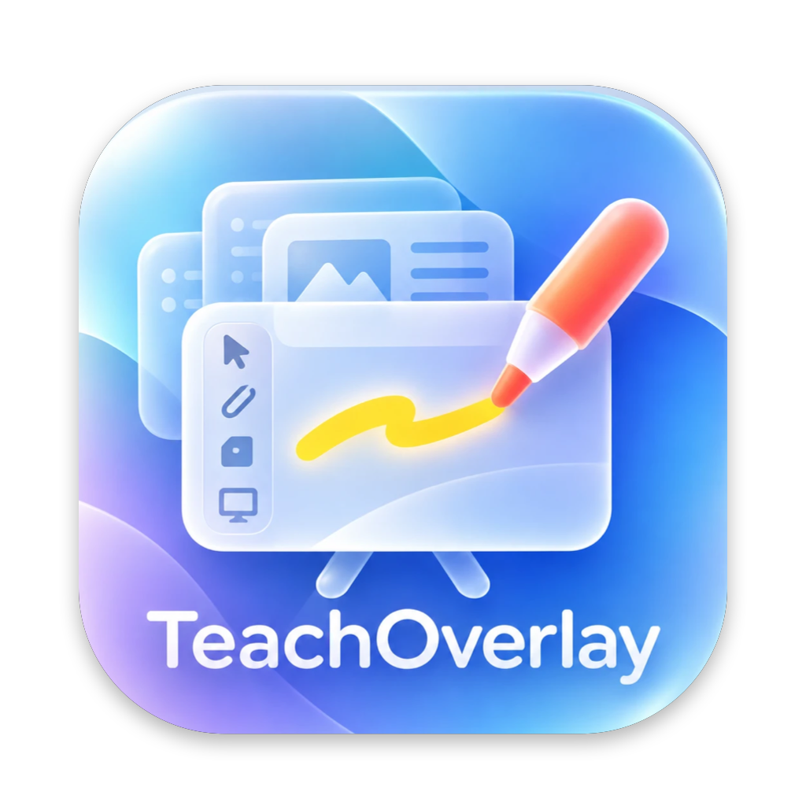

<h1 align="center">TeachOverlay</h1>

<b>繁體中文</b> · <a href="README.zh-Hans.md">简体中文</a> · <a href="README.en.md">English</a> · <a href="README.ja.md">日本語</a> · <a href="README.ko.md">한국어</a>

上課、錄影、直播時，讓學生和觀眾看清楚你按了什麼、點了哪裡。TeachOverlay 是一套給老師用的 Mac 螢幕教學工具：放大顯示按鍵、標示滑鼠、在螢幕上畫重點，還有白板、計時器、上下課鐘聲與抽籤。

## 功能

### 讓觀眾看清楚操作
- **放大顯示按鍵**：打字與快捷鍵即時放大顯示在螢幕上，快捷鍵會寫成「Command + C 複製」
- **快捷鍵紀錄**：按過的快捷鍵會停留在左上或右上角，方便學生跟著做
- **注音**：打中文時先顯示注音，選字後換成中文
- **滑鼠效果**：雙擊時出現擴散圓圈，並顯示按的是左鍵、右鍵，長按也看得出來
- **聚光燈**：周圍變暗，只照亮滑鼠附近
- **放大鏡**：把滑鼠附近的畫面放大給大家看
- **多螢幕同步**：接投影機時，每個螢幕都會顯示

### 在螢幕上講解
- **畫圖標註**：畫筆、螢光筆、直線、箭頭、方框、圓形
- **自動圖形**：隨手畫完停一下，就會變成工整的直線、圓形、方形或多邊形
- **尺與圓規**：可移動、旋轉的尺，靠著尺邊就能畫直線；圓規可以畫圓和弧
- **白板**：白板、黑板、方格、橫線、點格等背景，可以多頁並存成圖片
- **截圖標註**：選取畫面截圖後，直接在上面畫重點，存檔或拷貝貼到簡報

### 課堂小幫手
- **計時器**：倒數計時、番茄鐘，大大的數字浮在畫面上，全班都看得到
- **上下課鐘聲**：依課表自動打鐘（內建學校的西敏寺鐘聲，也可換成自己的音檔），並跳出通知
- **抽籤**：匯入名冊或直接用座號抽人，可以不重複、排除請假，還能自訂學號格式；可自動停止，也可以讓它一直滾動、由老師喊停
- **演講計時**：綠、黃、紅燈號提醒講者，剩 2 分鐘、最後 1 分鐘、時間到都會提醒，超時會閃爍並顯示超出多久；可以排講者名單
- **全螢幕時鐘**：數字或指針大時鐘，可以顯示在全部或指定的螢幕，也能顯示距離下一次鐘響
- **黑屏**：讓投影畫面暫時變黑，老師的筆電照常顯示
- **筆記**：寫講稿或上課重點，可以浮在畫面最上層

### 保護隱私
- 輸入**密碼、帳號、學號**等欄位時，螢幕上只會顯示「已隱藏」
- 使用 **LINE、Messenger、Instagram** 等聊天或社群軟體時，完全不顯示按鍵
- 所有資料只存在你的電腦，不會上傳到網路

### 其他
- 支援繁體中文、简体中文、English、日本語、한국어，預設跟隨系統語言
- 支援明亮與暗黑模式

## 下載與安裝

1. 到 [Releases](https://github.com/Yucheng0208/TeachOverlay/releases) 下載最新的 `.dmg`
2. 打開後，把 TeachOverlay 拖到「應用程式」資料夾
3. 第一次打開時，如果 macOS 說「無法打開」，請到「系統設定 → 隱私權與安全性」，在下方按「強制打開」

**系統需求**：macOS 13 以上、Apple Silicon（M 系列晶片）的 Mac

## 第一次使用：開啟權限

TeachOverlay 需要以下權限才能運作，請到「系統設定 → 隱私權與安全性」開啟：

| 權限 | 用途 |
|---|---|
| 輔助使用 | 顯示滑鼠效果、判斷密碼與隱私欄位、讀取注音選字結果 |
| 輸入監控 | 顯示鍵盤按鍵 |
| 螢幕錄製 | 放大鏡與截圖標註（不使用這兩項可以不開） |

開啟後不需要重新啟動。App 內的「權限」頁可以看到目前狀態。

## 常用快捷鍵

| 快捷鍵 | 功能 |
|---|---|
| ⌃⌥K | 顯示按鍵 開／關 |
| ⌃⌥C | 雙擊脈衝 開／關 |
| ⌃⌥S | 聚光燈（Esc 也可關閉） |
| ⌃⌥Z | 放大鏡 |
| ⌃⌥D | 畫圖標註 |
| ⌃⌥W | 白板 |
| ⌃⌥P | 截圖並標註 |
| ⌃⌥T | 計時器 |
| ⌃⌥R | 抽籤 |
| ⌃⌥B | 黑屏 |
| ⌃⌥L | 全螢幕時鐘 |
| ⌃⌥V | 演講計時 |
| ⌃⌥X | 一次關閉所有效果 |

⌃ 是 Control、⌥ 是 Option。畫圖時螢幕上方會出現工具列，也可以直接點選。

## 常見問題

**按鍵沒有顯示？**
請確認「輔助使用」與「輸入監控」都已開啟。更新 App 後若仍無效，請在系統設定中把 TeachOverlay 移除再重新加入。

**打密碼會被學生看到嗎？**
不會。密碼欄位、密碼管理器和終端機中的按鍵只會顯示「已隱藏」；聊天軟體中則完全不顯示。

**打注音只顯示注音、沒有中文？**
中文字是從輸入框讀取的，終端機和部分網頁編輯器讀不到，這時只會顯示注音。

**黑屏時筆電也黑了？**
螢幕設定為「鏡像輸出」時，筆電和投影是同一個畫面。請在「系統設定 → 顯示器」改成延伸顯示。全部黑掉時，點一下畫面或按 Esc 就會恢復。

**鐘聲沒有響？**
請在「鐘聲」頁開啟「依課表自動打鐘」，並確認上課日與音量。App 需要保持開啟（可以只留在選單列）。

## 問題回報與建議

歡迎到 [Issues](https://github.com/Yucheng0208/TeachOverlay/issues) 回報問題或提出建議。想自己編譯或修改，請看[開發說明](docs/DEVELOPMENT.md)。

## 作者與授權

作者：[Yu-Cheng Chang](https://github.com/Yucheng0208)（[個人網頁](https://www.yucheng208.net/)）

本專案以 [GNU General Public License v3.0](LICENSE) 授權。圖示使用 [Font Awesome Free](https://fontawesome.com)（圖示 CC BY 4.0、字型 SIL OFL 1.1）。
