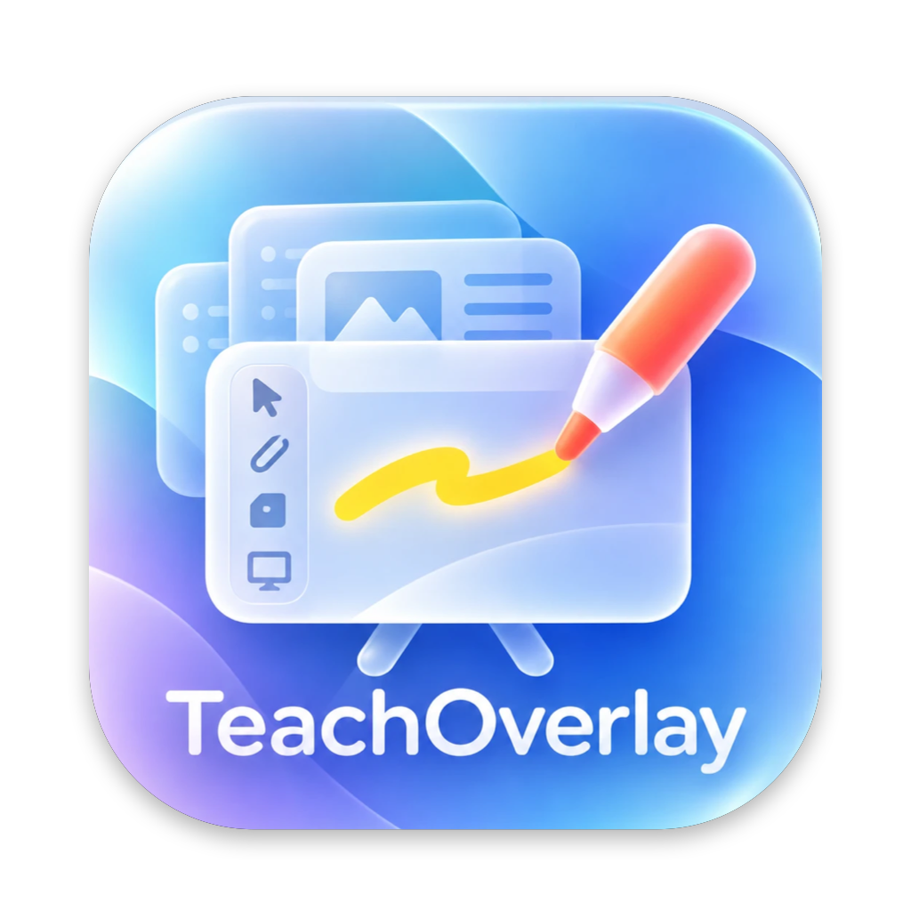

<h1 align="center">TeachOverlay</h1>

<a href="README.md">繁體中文</a> · <b>简体中文</b> · <a href="README.en.md">English</a> · <a href="README.ja.md">日本語</a> · <a href="README.ko.md">한국어</a>

上课、录屏、直播时，让学生和观众看清楚你按了什么、点了哪里。TeachOverlay 是一款给老师用的 Mac 屏幕教学工具：放大显示按键、标示鼠标、在屏幕上画重点，还有白板、计时器、上下课铃声与抽签。

## 功能

### 让观众看清楚操作
- **放大显示按键**：打字与快捷键实时放大显示在屏幕上，快捷键会写成“Command + C 复制”
- **快捷键记录**：按过的快捷键会停留在左上或右上角，方便学生跟着做
- **注音**：输入中文时先显示注音，选字后换成中文
- **鼠标效果**：双击时出现扩散圆圈，并显示按的是左键还是右键，长按也看得出来
- **聚光灯**：周围变暗，只照亮鼠标附近
- **放大镜**：把鼠标附近的画面放大给大家看
- **多屏幕同步**：接投影仪时，每个屏幕都会显示

### 在屏幕上讲解
- **画图标注**：画笔、荧光笔、直线、箭头、方框、圆形
- **自动图形**：随手画完停一下，就会变成工整的直线、圆形、方形或多边形
- **尺与圆规**：可移动、旋转的尺，靠着尺边就能画直线；圆规可以画圆和弧
- **白板**：白板、黑板、方格、横线、点格等背景，可以多页并存为图片
- **截图标注**：选取画面截图后，直接在上面画重点，保存或拷贝粘贴到演示文稿

### 课堂小帮手
- **计时器**：倒计时、番茄钟，大大的数字浮在画面上，全班都看得到
- **上下课铃声**：依课表自动打铃（内置学校的西敏寺钟声，也可换成自己的音频），并弹出通知
- **抽签**：导入名册或直接用座号抽人，可以不重复、排除请假，还能自定义学号格式；可自动停止，也可以让它一直滚动、由老师喊停
- **演讲计时**：绿、黄、红灯号提醒讲者，剩 2 分钟、最后 1 分钟、时间到都会提醒，超时会闪烁并显示超出多久；可以排讲者名单
- **全屏时钟**：数字或指针大时钟，可以显示在全部或指定的屏幕，也能显示距离下一次铃响
- **黑屏**：让投影画面暂时变黑，老师的笔记本照常显示
- **笔记**：写讲稿或上课重点，可以浮在画面最上层

### 保护隐私
- 输入**密码、账号、学号**等栏位时，屏幕上只会显示“已隐藏”
- 使用 **LINE、Messenger、Instagram** 等聊天或社交软件时，完全不显示按键
- 所有数据只保存在你的电脑，不会上传到网络

### 其他
- 支持繁體中文、简体中文、English、日本語、한국어，默认跟随系统语言
- 支持明亮与暗黑模式

## 下载与安装

1. 前往 [Releases](https://github.com/Yucheng0208/TeachOverlay/releases) 下载最新的 `.dmg`
2. 打开后，把 TeachOverlay 拖到“应用程序”文件夹
3. 第一次打开时，如果 macOS 提示“无法打开”，请前往“系统设置 → 隐私与安全性”，在下方点击“仍要打开”

**系统要求**：macOS 13 及以上、Apple Silicon（M 系列芯片）的 Mac

## 第一次使用：开启权限

TeachOverlay 需要以下权限才能运作，请前往“系统设置 → 隐私与安全性”开启：

| 权限 | 用途 |
|---|---|
| 辅助功能 | 显示鼠标效果、判断密码与隐私栏位、读取注音选字结果 |
| 输入监控 | 显示键盘按键 |
| 屏幕录制 | 放大镜与截图标注（不使用这两项可以不开） |

开启后无需重新启动。App 内的“权限”页可以看到当前状态。

## 常用快捷键

| 快捷键 | 功能 |
|---|---|
| ⌃⌥K | 显示按键 开／关 |
| ⌃⌥C | 双击脉冲 开／关 |
| ⌃⌥S | 聚光灯（Esc 也可关闭） |
| ⌃⌥Z | 放大镜 |
| ⌃⌥D | 画图标注 |
| ⌃⌥W | 白板 |
| ⌃⌥P | 截图并标注 |
| ⌃⌥T | 计时器 |
| ⌃⌥R | 抽签 |
| ⌃⌥B | 黑屏 |
| ⌃⌥L | 全屏时钟 |
| ⌃⌥V | 演讲计时 |
| ⌃⌥X | 一次关闭所有效果 |

⌃ 是 Control、⌥ 是 Option。画图时屏幕上方会出现工具栏，也可以直接点选。

## 常见问题

**按键没有显示？**
请确认“辅助功能”与“输入监控”都已开启。更新 App 后若仍无效，请在系统设置中把 TeachOverlay 移除再重新添加。

**输入密码会被学生看到吗？**
不会。密码栏位、密码管理器和终端中的按键只会显示“已隐藏”；聊天软件中则完全不显示。

**输入注音只显示注音、没有中文？**
中文字是从输入框读取的，终端和部分网页编辑器读不到，这时只会显示注音。

**黑屏时笔记本也黑了？**
显示器设置为“镜像”时，笔记本和投影是同一个画面。请在“系统设置 → 显示器”改成扩展显示。全部变黑时，点一下画面或按 Esc 就会恢复。

**铃声没有响？**
请在“铃声”页开启“依课表自动打铃”，并确认上课日与音量。App 需要保持开启（可以只留在菜单栏）。

## 问题反馈与建议

欢迎前往 [Issues](https://github.com/Yucheng0208/TeachOverlay/issues) 反馈问题或提出建议。想自己编译或修改，请看[开发说明](docs/DEVELOPMENT.md)。

## 作者与授权

作者：[Yu-Cheng Chang](https://github.com/Yucheng0208)（[个人网站](https://www.yucheng208.net/)）

本项目以 [GNU General Public License v3.0](LICENSE) 授权。图标使用 [Font Awesome Free](https://fontawesome.com)（图标 CC BY 4.0、字体 SIL OFL 1.1）。
